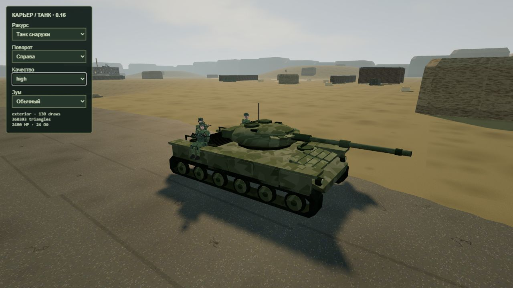
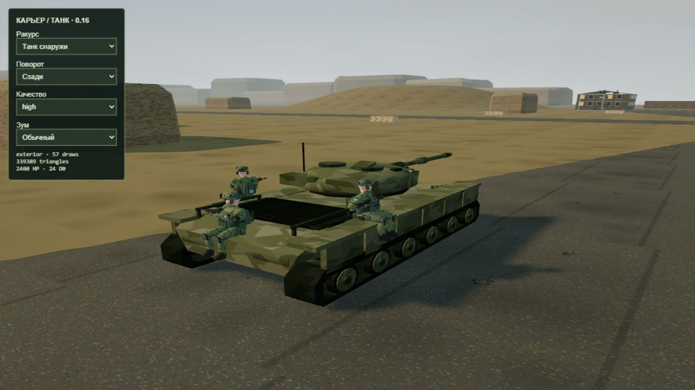
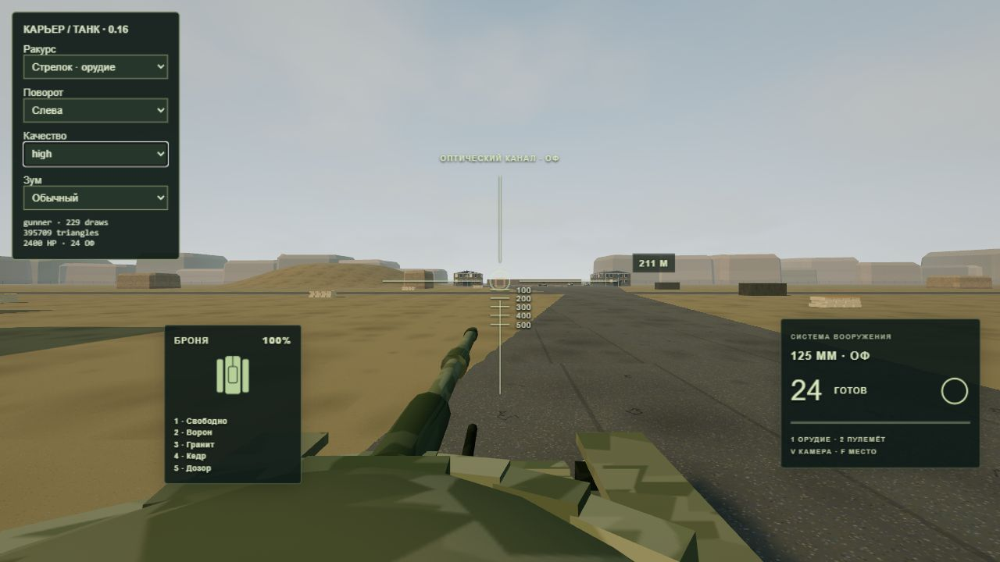
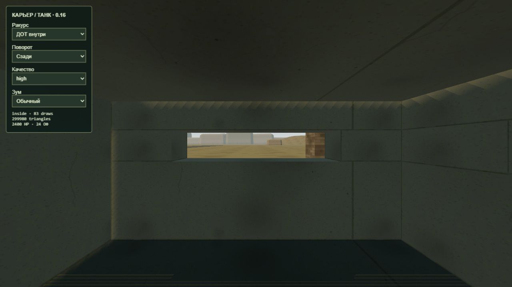

# «Карьер» и танк — внедрение по фазам

Исходный коммит: c34eb13. Ветка feature/quarry-tank, main не изменяется.
Версия игры остаётся 0.16. Пользователь уточнил: иммунитет к пулям только у
танка; хамви и квадроцикл сохраняют текущие HP, броню и уязвимость.

## Решения до внедрения

- Исходный документ описывал eac98a0. Сейчас протокол 26; MAP_LAYOUT_REVISION
  вычисляется от JSON-правок с фиксированной базой. При пересборке процедурной
  карты нужно изменить именно базу ревизии, иначе новые координаты не замечаются.
- Текущий бюджет начального JS 700000 gzip bytes, а не 512 KB. Держим существующий
  жёсткий лимит и отдельно сравниваем прирост с исходной сборкой.
- Сервер работает 60 Hz / 30 Hz snapshots с адаптивным fallback 20 Hz.
  Существующий bench-sim моделирует 20 Hz: для итогов потребуется сценарий 30 Hz.
- В документе несовместимы «только гранаты и ПТ-90» и разрешённый танковый снаряд.
  Снаряд другого танка наносит урон как отдельно указанное тяжёлое оружие;
  стрелковые пули и оба пулемёта танку не вредят.
- HP 2400 и 760 × 1.4 дают три попадания в корму, а не два. Итоговый множитель
  кормы/крыши подбирается под два прямых попадания; прямое попадание не получает
  одновременно второй полный урон от собственного взрыва.
- Снижение скорости гусеницей описано как 40% и 60%. Принимаем пороги 40/80%
  накопленного повреждения: сначала -40% скорости, затем поломка одной стороны.
- Ввод V уже занят сменой места, F посадкой. Для новых установок: V камера,
  F смена места, E посадка/выход; миграция только конфликтующих стандартных
  привязок, пользовательские назначения сохраняются.
- Пятиминутная неподвижность не равна ошибке: часовой и стрелок могут стоять.
  Проверяем отсутствие прогресса при активной команде движения.
- Реального Intel HD 610 здесь нет. FPS на нём, сетевые игровые ощущения и
  максимальное время кадра не объявляются проверенными по Node-бенчмаркам.

## Фаза 0

`scripts/measure-map-balance.mjs` измеряет реальные пути существующей навигации,
линии обстрела на подходе 25–120 м и плотность укрытий. Метод явно записан в
результатах, он не подменяет проезд танка проверкой прямых расстояний.
Исходные результаты сохраняются рядом с отчётом, новые — отдельными файлами.

## Фаза 1 — карта

`shared/quarry.js` пересобран: зеркальные A/E и B/D, рельеф, дороги, десять
ДОТов с проёмами, перемычками и крышей. `navigationNodes` поддерживают двери
1.3 м без уменьшения шага всей навигационной сетки. Визуал ДОТа не получает
декор закрытого склада. Обновлена база MAP_LAYOUT_REVISION и только карьерные
эталоны путей, прежняя геометрия сознательно заменена.

Было 288 коллайдеров; после пересборки менее 360 (допуск +25%). Пары ближайших
маршрутов теперь около 312 м вместо 282/312. Простреливаемость пары A/E около
15%, B/D около 19%; C ещё открыт: 92.8/100%, разница 7.2 процентного пункта.
Это оценка одного кратчайшего пути, не выбор ботом безопасного маршрута.
Static-world draws уменьшились с 619 до примерно 331; треугольники около 380k
против 377k. Точный последний состав — `quarry-tank-after-world.json`.
91 тест прошёл, build 512127 gzip bytes. Quarry p99 4.687 мс против 4.738 мс,
максимум 15.428 мс против 30.583; одиночные пики всё ещё выше 10 мс.
Команды: `npm test`, `npm run build`, `node scripts/measure-map-balance.mjs`,
`node scripts/measure-world.mjs`, `node scripts/bench-sim.mjs --output ...`.

## Фаза 2 — модель

Новый `src/tank-model.js`: корпус со скосами, блоки брони, моторная решётка,
башня, орудие с откатом, люк, катки и UV-анимация гусениц. Оригинальный атлас
512×512 UASTC с mipmaps создаётся `node scripts/bake-tank.mjs`; внешних ассетов
нет. Один непрозрачный Lambert-материал, отдельные движущиеся узлы.
LOD0: 2312 треугольников / 6 draws; LOD1: 1012 / 5; LOD2: 272 / 1.
Тест проверяет геометрию и бюджеты, но замена этих чисел измерениями GPU
не допускается: влияние на HD 610 и задержка первого входа пока не измерены.

## Фаза 3 — механика и сеть

`shared/vehicles.js` содержит единое описание tank: 2400 HP, 13/4.5 м/с,
пять мест. `shared/tank.js` разделяется предсказанием и сервером: разворот
на месте, ограничение уклона 32°, башня 0.9 рад/с, ствол 0.6 рад/с,
снаряды 190 м/с, 24 выстрела, перезарядка 3.2 с, смена на пулемёт 0.35 с.
Снаряд движется в существующем списке летящих боеприпасов, взрыв не наносится
в момент выстрела. Новые поля, тип боеприпаса и события добавлены в бинарный
кодек; протокол 27. Удалённый снаряд интерполируется с той же гравитацией.
Два танка стоят на зеркальных базах. Модель и атлас загружаются отдельным
chunk при выборе Карьера, геометрия двух машин готовится до посадки.

95 тестов прошли при последовательном запуске. В старом тесте полного матча
оставлены прежние проверки победителя/движения/убийств, но явно завершены
навигационные работы без лимита wall-clock: прежние случайные результаты
при параллельной нагрузке больше не маскируют регрессии.
Build: 514857 / 700000 gzip bytes; звук 2429751 / 2500000.
Проверки: пять мест, гибель водителя и пересадка, поворот на месте, башня,
кулдаун, смена оружия, поля snapshot и событие cannonShot.

## Фаза 4 — камера и интерфейс

`src/tank-camera.js` загружается с моделью: независимая орбита, мгновенный
поворот мышью, пружинное движение и лучи против стен/террейна. Для стены ближе
трёх метров безопасность важнее условного минимума: камера приближается,
а не проходит сквозь бетон. Ввод yaw водителя остаётся направлением корпуса;
vehicleCameraYaw передаётся только рендереру. V переключает вид, выбор хранится.

`src/tank-hud.js/css` — отдельный ленивый модуль. Дальномер/силуэт/экипаж
обновляются 10 Hz, фактический маркер ствола — через transform. Есть баллистические
метки 100–500 м из shared/tank.js, снаряды, кулдаун, нагрев, повреждения,
экипаж и 3× зум. Ассеты Battlefield не использованы. Камера с крыши и новый HUD
просмотрены в production WebGL; полные итоговые ракурсы ещё фиксируются.

96 тестов прошли, включая остановку камеры перед стеной и независимость поворота
мыши от пружины. Build: 517621 gzip bytes, аудиобюджет не вырос.

## Фаза 5 — урон и ремонт

Пули возвращают ricochet только для tank, HP не меняются и маркер урона не
вспыхивает. Хамви/квадроцикл в тесте продолжают терять HP. Броня танка:
лоб .55, борт/гусеницы 1, корма/крыша 1.6. При HP 2400 подтверждены
четыре прямых ПТ-90 в борт, два в корму, один в лоб оставляет 1982 HP.

Граната для танка настроена на 300 базового урона от поверхности корпуса
(для остальных машин прежние 240 от центра). На расстоянии 3 м от центра
борта тест даёт 264 урона, 44% повреждения гусеницы. Это сознательный тюнинг
предложенных 240: прежнее расстояние от центра делало 8–10 гранат недостижимыми.
Гусеница имеет эквивалент 600 HP: пороги 40/80%, ремонт 65 HP/с восстанавливает
HP корпуса и пропорционально гусеницы. Ниже 25% HP горение 12 HP/с;
ремонт подавляет огонь. После уничтожения остов живёт 20 с, респавн 120 с.

Боеприпасы доступны у всех пяти точек симметрично, а не только у северных A/B:
ПТ-90 пополняется существующим ящиком; танк получает по снаряду раз в 3 с
у ящика и раз в 5 с на своей базе. Проёмы ДОТа увеличены до высоты 1.82 м,
чтобы стоящий боец с глазами 1.65 м не упирался в верхнюю кромку.

100 тестов прошли. Есть проверки 1000 выстрелов без урона танку, двух типов
лёгкой техники, TTK по сторонам, гусениц, ремонта и взрыва за бетонной стеной.
Build: 518401 gzip bytes; новые аудиофайлы не добавлены.

## Фаза 6 — итоговая доводка и измерения

Устранены задержки бронирования техники ботами: после четырёх секунд без
сближения бот освобождает место и продолжает наземную задачу. Водитель и
стрелок танка больше не используют логику одноразового такси: удерживают точку,
затем выбирают следующий маршрут. Стрелок выбирает орудие/пулемёт, ждёт
фактического поворота ствола и учитывает баллистику. Для редкого пустого пути
у препятствия добавлен короткий проверяемый отход без телепортации и отмены
приказа. Пополнение от нейтральных ящиков доступно обеим сторонам; team=-1
сохраняется бинарным кодеком.

Оптимизация не уменьшает частоты сервера. Кэш следа машины проверяет позицию,
поворот, тип и масштаб; гипотетические позиции не кэшируются как текущие.
Проверка столкновения машины использует существующие пространственные корзины.
Парный промежуточный замер сохранён в `quarry-tank-before-vehicle-cache.json`;
итоговый отдельный прогон — `quarry-tank-final-server.json`. Начальный тяжёлый
сценарий до кэша имел p99 6.28 мс. Сравнение Node-таймингов не заменяет FPS.

После замечания пользователя переработан и сам танк: цельный клиновидный
корпус, низкая округлая башня, отдельные блоки брони, шесть катков с дисками,
открытая лента гусениц и более длинное орудие. Камуфляж имеет общий масштаб
в метрах. Видимая точка дула и серверная баллистика используют одну константу;
проверены наклон и масштаб корпуса. Точка для стоп десанта раньше выходила
за досягаемость ног и распрямляла колени. Теперь бёдра лежат вдоль брони,
голени опущены, ботинки находятся снаружи бортовых экранов/кормы. Высота мест
и зоны экипажа согласованы с посадкой.

ДОТы получили бетон без накладок обычной стены: декоративные кромки раньше
визуально заходили в линию огня, хотя серверные проёмы были открыты. Новый
тест проверяет лучи уже по отрисовываемым треугольникам на высоте дула и точную
высоту пола. На A/E сохранены открытые склады, на B/D — заводские площадки;
в центре остался котлован. Перезапечена маска тени земли.

| Показатель | Итог |
| --- | --- |
| Версия / протокол | 0.16 / 27 |
| Коллайдеры карты | 298 против исходных 288 |
| Статические material draws | 345 против 619, без culling и теневых проходов |
| Статические треугольники | 381920 против 377442: +1.19% |
| Танк LOD0 / LOD1 / LOD2 | 4344 / 1940 / 264 треугольника; 6 / 5 / 1 draws |
| Теневой proxy вблизи | дополнительно 608 треугольников / 1 draw |
| Начальный JS gzip | 518920 / 700000 bytes текущего жёсткого бюджета |
| Всё runtime-аудио | 2428599 / 2500000 bytes |
| Сервер: два танка, 30 ботов, 7 игроков, 60/30 Hz | avg 1.451, p99 3.453, max 10.907 мс |
| Доплата полей танка в одинаковом 5-секундном trace | +1.20% всего, +3.21% первого полного snapshot |
| Проезд по всем 38 рёбрам маршрутов | 4958 проб, препятствий нет, максимальный уклон 14.31° |
| 5 минут / 30 ботов | 5 посадок в танки, 4 выстрела орудия, 13 пулемётных; застреваний по критерию >10 с нет |
| Тесты | 106 прошли, 0 ошибок |

Скрипт бенчмарка по-прежнему предупреждает о превышении собственного лимита
максимального шага 10 мс: 10.907 мс больше него, хотя целевой p99 ≤6 мс выполнен.
Пары кратчайших путей отличаются менее чем на 2%, см. after-balance.json.
Открытость C остаётся 92.8/100% на выбранных маршрутах, разница 7.2 п.п.;
это не обещание одинакового исхода реального матча.

Визуальный просмотр production WebGL выполнен через компьютерный браузер:
все A–E, ДОТ изнутри/снаружи, четыре стороны модели, два вида водителя,
орудие, пулемёт, кулдаун, повреждение гусеницы и 3× увеличение. HUD просмотрен
в 1280×720 и 1920×1080, высокое и низкое качество. Журнал просмотра без
предупреждений и ошибок. После замечания о модели повторно сняты четыре
ракурса танка и прицел. Снимки ниже показывают окончательную модель.
Остальные локальные снимки находятся в `.perf-local/quarry-*.png`;
воспроизвести просмотр можно командой `npm run preview:tank`.

Ограничения приёмки: Intel HD 610 недоступен; 30+ FPS на нём и приращение
GPU-времени не измерены. Браузерный интерфейс позволяет менять размеры окна,
но не задаёт deviceScaleFactor=2: это обычные WebGL-снимки, не заявленные
в документе DPR2-скриншоты Playwright. Полный матч двух реальных сетевых клиентов
не проведён; проверены кодек, сервер и предсказание 100±30 мс с отклонением
менее 20 см. Живое качество нового звука на устройстве пользователя не оценивалось.
После слияния ветки потребуется совместное обновление клиента и сервера
из-за протокола 27; эта ветка сама не развёртывает игру на основном сайте.

## Дополнение — новые выстрелы снайперских винтовок

Учтены загруженные пользователем OGG из 3d5e250: marksman-1 только у DMR-12,
marksman-2 только у СВ-98М. Старые звуки больше не выбираются случайно.
Исходники сохранены побайтно в art-source/audio/gunshots/user-*.ogg,
производные OGG/AAC воспроизводимо готовит prepare-sniper-audio.mjs.
У второго оригинала сильная атака начиналась через 246.5 мс; в игровых
форматах она теперь наступает за 0.4–4.7 мс, без изменения оригинала.
Пиковый уровень ограничивается существующим аудиомикшером. Результаты анализа
записаны в docs/perf/sniper-recordings.json; общий аудиобюджет соблюдён.
