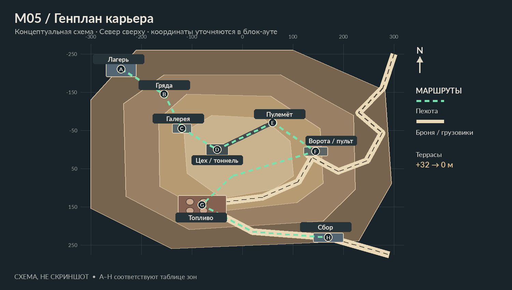
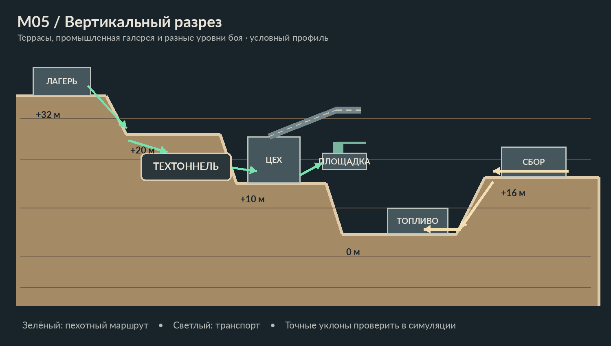
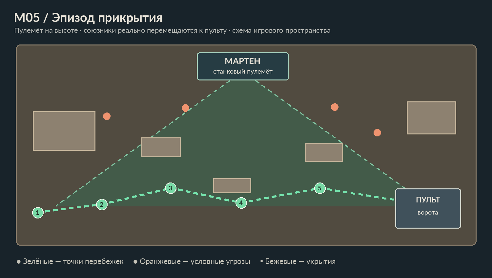
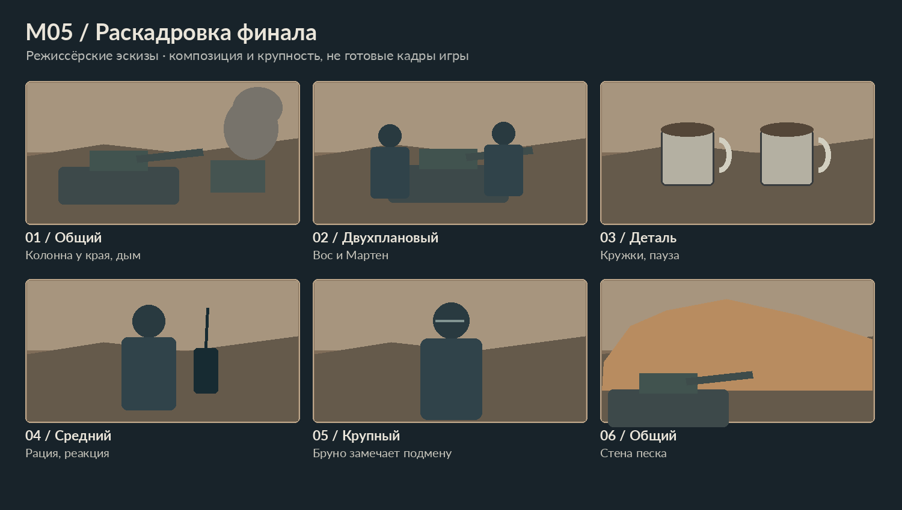

# SECTOR 09 · Миссия 05 «Карьер»
## Режиссёрский дизайн-документ и техническое задание для Codex

**Проект:** https://github.com/fen417/gpt-test\
**Кампания:** «Песок и сталь», акт II «Марш»\
**Целевая ветка:** `main` (актуальное состояние на момент начала работ; перепроверь его)\
**Версия документа:** 1.0 · 25.11.2026\
**Статус:** утверждённая сюжетная концепция; требования к реализации, не отчёт о готовой миссии.

> Ты — ведущий разработчик сюжетных FPS, технический режиссёр, level designer и специалист по Three.js, Blender, игровому ИИ и оптимизации. Реализуй целиком пятую миссию кампании «Карьер» согласно этому документу. Не ограничивайся серым прототипом или заглушками. Сохрани совместимость с текущей игрой, предыдущими четырьмя главами и обоими графическими API. Сначала изучи код и активы, затем создай рабочий маршрут, поставь сцены, доведи окружение и звук, проведи проверки. Это единый эпизод с началом, кульминацией и финалом, а не набор арен.

**Главное:** игрок сначала помогает Восу войти в карьер, затем в роли Воса помогает Мартену; в финале обе группы спасают снабжение бригады. Дарго перехватывает доверие к «Маяку», а приближающаяся буря ведёт в М06.

**Цель качества:** режиссура уровня сюжетных миссий Call of Duty / Battlefield 3–4 — ясная композиция кадров, живые персонажи, действия союзников в кадре, плавные переходы и события, которые игрок видит своими глазами. Не копируй чужие миссии, модели, музыку или кадры; ориентируйся на язык постановки. Все материалы должны выглядеть как часть существующей SECTOR 09.

**Ожидаемый результат:** одна полноценная одиночная миссия на 35–45 минут первого прохождения; новый ландшафт, 7 актов, 2 игровых героя, 4 основные катсцены и короткие внутригеймплейные постановочные события, новые реплики и озвучка при наличии доступа к синтезу, полноценные чекпоинты и итоговый экран.

<!-- page -->
## 01 · Канон и непрерывность сюжета

- М01 «Высадка у вади»: Мартен и взвод Дюрана захватили станцию Аль-Хадры, подали сигнал «Маяк». Возможны потери бойцов; ранее уничтожали запасы противника.
- М02 «Рассвет над Аль-Хадрой»: Вос, командир «Сокола-7», и рота спасли пехоту. У штабной машины получены приказы. Дарго: «Вы удержали Аль-Хадру. Но у карьера вас уже ждут. Маяк не останется вашим».
- М03 «Колонна»: Мартен уже знаком с Восом; они ехали вместе в Тель-Мазин, говорили о доме, чае и кофе. Засада разделила их. Вос, Тимо и Рафа при допустимом исходе вновь появляются у штаба. Харранти передал карту. Два UH-60 эвакуировали пехоту.
- М04 «Под крышами»: Мартен добыл сведения о топливном маршруте у диспетчера Нахара или по журналу и записи. На водомерной станции передал их Орлову; вышел через служебный тоннель. «Принял! Схема у нас. Топливо уходит на карьер. Мартен, выводи людей». Финальный кадр — проход в тоннель, не новый бой и не вылет на вертолёте.

### Начало и конец новой главы

М05 начинается через несколько часов: полевая база у карьера, после вывода группы из Нахара. Не повторять отрывок М04 и не придумывать новое спасение диспетчера. Объяснить разрыв времени одной титровой строкой и разговорами. Бригаде уже не хватает топлива для следующего перехода к осаждённому Эр-Сахиру. Задача — получить топливо, а не взорвать склад. Дарго готовился к операции заранее и оставил приказ уничтожить запасы при потере узла. Фальшивый приказ по радио в финале — намеренная интрига, а не доказательство гибели Орлова. М06 «Песчаная буря» должна продолжить движение без надёжной связи, М07 — оставить развязку противостояния с Дарго, М08 — рубеж на пути к порту. Не убивать Дарго и не завершать войну здесь.

### Персонажи и роли

- Ян Мартен — управляемый пехотинец; уставший, внимательный к людям. Ирвин Вос — второй игровой герой, командир «Сокол-7»; заботится о своём экипаже.
- Дюран — ведёт пехоту; Ласко — медик; Бруно — радист; Кейн — прикрытие. Для погибших — резервные бойцы с собственными нейтральными репликами. Не воскрешать погибших ради красивой сцены.
- Тимо Рэй — механик-водитель, Рафа Ким — заряжающий. Холт — командир роты. Харранти — командование; Орлов — «Маяк»; Дарго — противник, голос в эфире.
- Один рабочий карьера (новый персонаж, без имени или рабочее имя Самир) знает оборудование; ещё 2 рабочих — фон и эвакуация. Не превращать их в боевых ботов. Участие диспетчера Нахара — только краткая связь, если он спасён.

<!-- page -->
## 02 · Структура и темп

| Этап / ID | Целевое время | Игровой режим и результат |
|---|---|---|
| 1 · `camp` | 4–5 мин | Встреча, выбор реплики, инструктаж. Группа выходит из лагеря. |
| 2 · `overlook` | 4–6 мин | Панорама, осмотр ориентиров, спуск. Вход в техническую зону. |
| 3 · `works` | 6–7 мин | Промкомплекс, рабочие, питание, ворота. Отряд достигает площадки. |
| 4 · `cover` | 4–5 мин | Станковый пулемёт, прикрытие действий союзников. Открыт проезд. |
| 5 · `armor` | 6–8 мин | Игрок — Вос. Прорыв по серпантину, помощь пехоте. |
| 6 · `fuel` | 7–9 мин | Игрок — Мартен. Пожар, спасение заправщиков. |
| 7 · `finale` | 2–3 мин | Отдых, ложный приказ, голос Дарго, стена песка. |

Сумма — ориентир, а не принудительный таймер. Спокойное прохождение и исследование могут занять больше. Не растягивать время бесконечными волнами. У боя должна быть причина, понятная цель и конец. Ни одна задача не сводится к уничтожению всех противников на уровне. Сценарная цель открывается по выполнению действий, а не просто по истечению секунд. Разговоры, не влияющие на задачу, прерываются угрозой и могут продолжиться в паузе.

### Три правила постановки

1. **Сначала показать, потом дать действовать.** Панорама даёт игроку представление о карьере. С пулемётной площадки видны будущий танковый маршрут и союзники. В роли Воса игрок узнаёт место, где только что воевал. В финале видит результаты спасения машин.
2. **Драматургия через причинность.** Ворота открываются благодаря работе союзников; танки входят через эти же ворота; взрыв меняет цель операции; спасённые машины реально уезжают. Не спавнить объект или персонажа на глазах игрока и не телепортировать их между соседними кадрами.
3. **Контроль отдавать вовремя.** Крупные постановочные сцены — короткие, внутри движка, с плавным возвратом в игровой вид. В безопасных сценах свободный взгляд и движение предпочтительнее долгой блокировки. Не оставлять игрока без управления во время реальной угрозы.

**Основные катсцены:** C1 встреча в лагере; C2 переход Мартен → Вос; C3 взрыв и возврат Вос → Мартен; C4 финал. Остальное — короткие события внутри игры: рабочий выходит из укрытия, оборудование запускается, союзники перемещаются, колонна появляется в проезде.

<!-- page -->
## 03 · Генплан карты: карьер, а не посёлок

**Создать отдельную карту кампании**, например `quarry-m05`, не менять сетевой `quarry` в `shared/quarry.js`. Можно переиспользовать пригодные модели, материалы, камни, транспорт, но основная форма рельефа и сценарные участки новые. Никаких восьми одинаковых домов, плоской чаши или заполнения пространства повторяющимися кубами.

Координаты ниже — проектные ориентиры, не готовые координаты игры. Оси и ноль согласовать с текущей симуляцией; X на восток, Z на юг, Y вверх. Играбельное ядро около 640 × 560 м; видимая панорама порядка 1,2–1,6 км, дальний рельеф неигровой. Перепад высот между лагерем и дном 28–42 м. Уступы 6–12 м, инженерные дороги и пешеходные пути имеют физические связи. Размеры корректировать после блок-аута, не отступая от топологии.

**Порядок пехоты:** лагерь → обзорный край → лестница/галерея → техтоннель → дробильный зал → верхняя пулемётная площадка → нижний пульт → площадка у склада → топливный двор → выход. **Порядок танков:** внешний сбор → дальняя дорога → верхний поворот → ворота → нижний серпантин → дробильный комплекс → склад → выезд. Оба маршрута пересекаются визуально и в логике, но не заставляют персонажей проходить сквозь стены.

<!-- page -->
## 04 · Рельеф, архитектура и масштабы

| Зона | Проектный центр X/Z | Y / масштаб и назначение |
|---|---|---|
| A. Лагерь | −240 / −210 | +32; 75 × 55 м, ремонт, 2–3 палатки, машина штаба, танк. |
| B. Обзорная гряда | −155 / −145 | +30; терраса 35 × 20 м, панорама на всё ядро. |
| C. Техгалерея | −120 / −55 | +17; лестницы, внешний мостик, вход в тоннель. |
| D. Тоннель / цех | −50 / 0 | +6…+16; подземный отрезок 35–55 м, зал 44 × 30 м. |
| E. Пулемёт | +60 / −70 | +18; площадка 16 × 12 м над двором, парапет и вход. |
| F. Пульт / ворота | +145 / +5 | +4…+9; двор 90 × 60 м, ворота и подъёмник. |
| G. Топливный узел | −80 / +145 | 0…+3; 105 × 85 м, резервуары, грузовые боксы. |
| H. Сбор/выход | +170 / +230 | +14…+22; выезд к пустыне, простор для колонны. |

- Серпантин для существующих танков: ширина 10–13 м на прямой, 14–18 м на поворотах; продольный уклон проверить в реальной симуляции (ориентир 8–12%, не скачки высоты). Ровные переходы между сегментами, без зацепов днища. Место для разворота/разъезда вне опасных кромок. Ограждения и каменные барьеры визуально объясняют границы.
- Пешеходные проёмы и коллизии — не менее 1,3–1,5 м чистой ширины на одиночном пути; для движения группы 1,8–2,4 м. Двери высотой не менее 2,2 м. Лестницы с реальной проходимой коллизией; проверить подъём без прыжков, приседания и толкания сквозь стену. Для ботов — навигационные связи между уровнями и обходы застреваний. Не использовать одну огромную box-коллизию для сложной GLB-модели.

<!-- page -->
## 05 · Художественная проработка и игровые пространства

### Что должно быть видно игроку

Карьер — светлая известняковая порода с серо-бежевыми и тёплыми песочными слоями; выраженные ступени выемки, уступы с осыпями, следы работы техники, рытвины дороги. Индустриальная архитектура: старый бетон, стальная ферма дробилки, тёмные конвейерные ленты, канаты, лестничные клетки, трубы и кабельные трассы, обслуживаемая диспетчерская. Выделить 4–6 уникальных силуэтов: высокая дробилка, длинный наклонный конвейер, лестничная башня, ряд резервуаров, диспетчерский блок, главные ворота. Вид издалека должен совпадать с геометрией вблизи.

- Лагерь: тенты, коробки боеприпасов, ремонтная тележка, ящики, канистры, немного техники. 4–6 фоновых акторов, занятых делом, а не стоящих строем. Следы недавних боёв на машинах, но без чрезмерной грязи.
- Гряды: натуральный скальный силуэт и осыпь, пыльная сухая дорога; редкие выцветшие кусты и пожелтевшая трава, не зелёный газон. Не допускать клиппинга растительности и парящих камней.
- Цех: обслуживаемый двухуровневый зал; видимость через ограждённые галереи, характерные цветовые ориентиры. Рабочие механизмы стоят далеко от маршрута. В тоннеле минимум два осмысленных изгиба и вентиляционные/технические ниши, а не коридор из одинаковых комнат. У игрока всегда есть визуальный ориентир выхода.
- Топливный двор: низкие ограждения резервуаров, парковочные места трёх цистерн, насосные будки и одна площадка для манёвра. Сюжетные взрывы происходят за безопасной для игрока зоной; дым не закрывает полностью маршруты или цели. Механика пожара сценарная, не симуляция распространения огня.

### Материалы, свет, эффекты

Сохранять текущий PBR-пайплайн и настройки графики. Бетон, порода, металл должны иметь локальные текстурные вариации, roughness, normal и аккуратный контраст; не вымывать всю детализацию общей цветокоррекцией. Избегать чрезмерных чёрных теней, ряби и z-fighting. Не превращать всё в одинаковую грязно-жёлтую поверхность. Внутри — читаемый непрямой свет и локальные источники, без необходимости менять глобальное освещение других карт. На улице — тёплый косой свет, постепенное изменение к закату. В конце локальный дым пожара и дальняя пыльная буря, не постоянный фильтр на всю картинку. При отключённых постэффектах маршруты и взаимодействия остаются читаемыми.

**Blender:** собрать модульные наборы, но уникальные промышленные узлы моделировать отдельно. Сохранить исходники и экспорт `.glb`, проверить масштабы, нормали, UV, LOD, pivots, имена подвижных частей, коллизии. Все сторонние ассеты — с проверяемой лицензией и источником. Не использовать украденные модели из COD/BF.

<!-- page -->
## 06 · Этап 1 — «Старые знакомые»

**Цель HUD:** «Встретьтесь с экипажем „Сокола-7“», затем «Подойдите к Харранти», «Следуйте за отделением». Стартовый чекпоинт CP0. Игрок — Мартен. Действия происходят в безопасном лагере; оружие опущено, выстрелы/гранаты заблокированы только здесь. Выбор оружия до старта через существующее меню; в лагере разрешён осмотр и пополнение боезапаса.

### C1 · Вступление (35–50 сек, часть под управлением)

0–4 с: чёрный экран → шум ветра, отдалённые двигатели → титр «Окрестности карьера. Несколько часов после Нахара». 4–12 с: низкий плавный кадр мимо колеса ремонтной машины, механик передаёт инструмент товарищу, санитар осматривает руку бойца. 12–22 с: общий план подъезда «Сокола-7», машина тормозит естественно, пыль оседает. 22–32 с: Вос открывает люк, поднимается и спускается с брони; камера за плечом Мартена, встреча. 32–38 с: средний план Воса, затем рука Мартена; переход в первое лицо с прежним FOV. Далее свободный взгляд и движение, реплики идут по близости, а не при отдалённом игроке. Если персонажи уже на месте, сцена не перескакивает и не повторяется.

### Диалоги — встреча

- `vos.reunion` Вос: «Мартен? А я думал, вас до вечера из Нахара не вытащат».
- `marten.reunion` Мартен: «Сам удивлён. А где остальные?»
- `vos.crew` Вос: «Кто на ремонте, кто у медиков. Собираем роту по частям».
- `timo.warn` Тимо: «Если ещё кто-нибудь скажет, что самое страшное уже позади, я его лично из танка высажу».
- `rafa.coffee` Рафа: «А кофе у нас так и не появился».
- `marten.coffee` Мартен: «Помню. Ты мне обещал».
- `lasko.check` Ласко, если жив: «Как нога? Дай глянуть, пока нас опять не погнали».
- `marten.check` Мартен: «Держится. Лучше посмотри, чтобы остальные не развалились».

Необязательный разговор с Восом: «Думал, что не встретимся» / «Сколько осталось машин?» / «Поговорим после задания». Вос соответственно: «Я тоже. Хорошо, что ошибся» / «Меньше, чем хотелось бы, но хватит» / «Договорились. Теперь держимся вместе». Варианты влияют только на следующую реплику; не затягивать, через 8–10 с доступно продолжение. Условный эфир от диспетчера: «Ваши координаты верны. Дорога проходит через нижние ворота». Если погиб, Орлов говорит: «Запись диспетчера подтверждена. Ищите нижние ворота».

<!-- page -->
## 07 · Этап 1 (продолжение) и этап 2 — «На краю»

### Инструктаж у карты

Харранти ждёт у капота; в кадре сложенная карта с визуальными ориентирами, он показывает на карьер, Вос наклоняется, Мартен может смотреть на обоих. Не делать статичное меню вместо сцены. Доклад длится около 35–50 с.

- `harranti.fuel` Харранти: «Через этот карьер проходит почти всё снабжение Корпуса в регионе. Нам нужны их запасы».
- `vos.fuel` Вос: «Сколько топлива осталось у нас?»
- `harranti.range` Харранти: «Чтобы добраться туда. Обратно — уже не уверен».
- `marten.risk` Мартен: «А если они уничтожат склад?»
- `harranti.plan` Харранти: «Поэтому вы пойдёте первыми. Откройте проезд, „Сокол“ войдёт следом. Топливные машины не трогать».
- `duran.ready` Дюран: «Проверили магазины? Держимся вместе. Мартен, идёшь со мной».
- `vos.depart` Вос: «Увидимся внизу. На этот раз не потеряем друг друга».

**Переход:** Вос и экипаж возвращаются к танку. Танк действительно покидает лагерь или уходит за дальний холм; пехота идёт своим маршрутом. Не исчезать перед игроком. CP1 на гряде.

### Этап 2 · Осмотр карьера

HUD: «Осмотрите карьер» — три области интереса (резервуары, конвейер/цех, ворота). Использовать существующий бинокль/оптику, если доступно, иначе обычный взгляд с удержанием цели в центре 0,8–1,2 с. Маркер появляется только при достаточной видимости и не закрывает фигуры. При включённой помощи цели выделяются ненавязчиво. После осмотра — «Спуститесь к технической галерее».

- `orlov.overlook` Орлов: «На краю открывается весь узел. Осмотрите склад, дробилку и проезд для техники».
- `kane.trucks` Кейн: «Странно. Грузовики загружены, но никто не уезжает».
- `duran.order` Дюран: «Может, ждут приказа».
- `bruno.wait` Бруно: «Или нас».
- `marten.gate` Мартен: «Ворота закрыты. Похоже, придётся идти через цех».
- `orlov.route` Орлов: «Вижу по схеме. Есть техническая лестница. Ведите группу туда».

Небольшой патруль и охрана галереи уже присутствуют в мире. Игрок может пройти часть участка незаметно, пригнуться и обойти патруль или начать бой; обнаружение не вызывает провал. При тревоге — ограниченное подкрепление из соседнего прохода, не материализация рядом. Пехота спускается по лестницам с нормальными анимациями. В первом бою — умеренное число противников, ясные силуэты и высотные позиции. Завершение по входу группы в безопасный техпроход; отставший бот автоматически догоняет через допустимый путь. CP2 перед тоннелем.

<!-- page -->
## 08 · Этап 3 — «Под землёй»

**Цели:** «Найдите рабочих», «Прикройте запуск оборудования», «Доберитесь до верхней площадки». Из открытой пустыни игрок входит в прохладный, гулкий техтоннель. Слышны вентиляция, капли, дребезг металлических листов, приглушённая перестрелка снаружи. Внутри есть локальные светильники, аварийные указатели и достаточно света для ориентации даже на Low.

### События

1. Вначале 1–2 коротких контакта в тоннеле и галерее, затем звук боя стихает. Дюран останавливается у закрытой двери. Из-за неё слышен голос рабочего. Игрок открывает дверь обычным взаимодействием; рабочий выходит с поднятыми руками, осматривается, постепенно опускает их. Двое других остаются в укрытии.
2. Рабочий объясняет приказ об уничтожении топлива. Он показывает на большой технический пульт, а не на абстрактный маркер. Мартен отвечает. Рабочий идёт к пульту только когда маршрут безопасен; Дюран и один боец прикрывают, второй проверяет галерею. Игрок не обязан вручную нажимать три рубильника.
3. Рабочий выполняет анимацию подключения питания (достать ключ, открыть крышку, потянуть рычаг). Свет по секциям постепенно загорается, реле щёлкают, запускается конвейер, вентилятор и часть механизмов. Далеко видны медленно поднимающиеся промышленные створки. Главный транспортный проезд пока блокирует нижняя секция управления; это причина следующего эпизода.
4. Короткое столкновение в двухуровневом цехе: противники выходят по физическим лестницам и дверям, не из пустого воздуха. Рабочие пригибаются и уходят за укрытие, союзники защищают. После контакта отряд проходит на верхнюю площадку. У рабочего остаётся безопасное место до эвакуации.

### Реплики

- `worker.appear` Рабочий: «Не стреляйте! Мы здесь работаем. Они нас заперли».
- `marten.worker` Мартен: «Спокойно. Что происходит на складе?»
- `worker.warning` Рабочий: «Они ещё утром начали вывозить документы. Потом приказали всем спуститься вниз».
- `marten.who` Мартен: «Кто отдавал приказ?»
- `worker.major` Рабочий: «Не знаю имени. Майор какой-то. Все его боялись. Если уйдут, сожгут всё топливо».
- `duran.dargo` Дюран: «Дарго. Мы уже слышали это имя».
- `worker.power` Рабочий: «Могу дать питание. Но главный проезд управляется снизу. Там второй пульт».
- `marten.coverWorker` Мартен: «Давай. Мы прикроем».
- `worker.live` Рабочий: «Есть! Слышите? Теперь можно открыть ворота с нижней площадки».
- `duran.move` Дюран: «На верхний уровень. Не отставайте».

**Завершение:** питание включено, оборудование синхронизировано, союзники на подходе к площадке. CP3. Если рабочий недоступен из-за ошибки маршрута — резервный доступ к пульту у Дюрана/игрока, без софтлока. Не оставлять рабочему возможность случайно умереть до выполнения незаменимого сценарного действия.

<!-- page -->
## 09 · Этап 4 — «Держи проход!»

**Цель:** «Прикройте отделение у нижнего пульта». Дюран показывает на стационарный крупнокалиберный пулемёт на площадке E. С него видно открытый двор, маршрут союзников и вход транспорта. Игрок имеет полный обзор через сектор оружия, никаких непопадаемых целей за геометрией. Сначала дать 4–8 с освоиться и занять пулемёт. CP4 перед взаимодействием.

### Сценарий прикрытия (4 фазы)

- P1: Дюран и два бойца пересекают первый открытый участок, останавливаются в укрытии. Противник уже виден возле промышленной галереи. При попаданиях/подавлении освобождается окно для перебежки. Если игрок стреляет в союзников, штатно не наносить им урон от дружественного огня, без бонусов за попадания.
- P2: группа двигается к среднему укрытию. Один боец помогает условно раненому резервному союзнику, прикрытие остаётся у Дюрана. Медик или резервный актор действительно приседает, выполняет короткое лечение, затем оба продолжают путь. Не использовать необратимую обязательную гибель именованного бойца.
- P3: вражеский Humvee въезжает по дороге, слышен мотор и реплика. Машина имеет видимый путь и штатную модель, не появляется в центре двора. Пулемёт/союзники могут оттеснить или вывести её из боя. Не требовать от пулемёта уничтожения цели, которую он по штатным правилам не повреждает: альтернативно вызвать помощь Воса или добиться ухода машины. Угроза понятна по поведению экипажа.
- P4: двое достигают пульта и удерживают позицию, рабочий/боец вводит команду. Ворота физически открываются. Прогресс зависит от прибытия акторов и окончания анимации. Нет бесконечных волн. Стрелок может выйти из-за станка, помочь пехоте своим оружием и вернуться; если отойдёт надолго, союзники укрываются и зовут его, но не проваливают миссию мгновенно.

<!-- page -->
## 10 · Пулемёт: управление, обратная связь, реплики

### Игровая механика

- Использовать штатные баллистику, ввод, модель турели, аудио и эффекты, где они подходят. Не подменять оружие декорацией. Добавить отдельную неподвижную установку (предпочтительно локальная campaign-entity) с собственным pose, hit/collision и сектором yaw/pitch. Не превращать её в доступный сетевой Humvee без колёс. Крепление, станок, рукоятки, лента/короб и pivot должны совпадать с анимацией.
- Вход — стандартное взаимодействие; короткая 0,7–1,1 с анимация захвата рукояток, камера приходит к прицелу, личное оружие скрывается. Выход — обратное движение, возврат личного боезапаса, безопасная точка рядом со станком. Не вращать тело на 360° вопреки модели. Оружие реально следует прицелу и имеет верные точки вылета эффектов.
- Сектор и высота подбираются по блок-ауту, а не по произвольным числам; все обязательные угрозы должны находиться внутри видимого сектора. Прицел, шкала нагрева, понятное состояние охлаждения. Не злоупотреблять тряской; настройка camera shake действует. Боезапас достаточен на эпизод; если ограничен, предусмотреть пополнение рядом. Восстановление чекпоинта сохраняет фазу, боезапас, состояние перегрева и занятость станка.
- Подавление — игровое состояние угрозы, а не декоративный звук: при близких попаданиях или реальном попадании противник временно прячется/теряет возможность прицельного огня. Сценарная группа начинает перебежку после читаемого окна, имеет безопасные места ожидания, не бежит по таймеру под бесконечный огонь. Не заставлять игрока поражать каждого врага. Ограничить число активных групп; поддержка союзников обеспечивает выход из затяжного боя.

### Реплики с реакцией на состояние

- `duran.mount` Дюран: «Мартен, видишь пулемёт на площадке? Займи его. Мы пойдём снизу».
- `marten.exposed` Мартен: «Вас оттуда будет видно как на ладони».
- `duran.aim` Дюран: «Вот именно. Поэтому не промахивайся».
- `marten.mounted` Мартен: «На месте. Вижу ваш маршрут».
- `duran.cross` Дюран: «Первый участок! Пошли, пошли!»
- `bruno.middle` Бруно: «У укрытия. Дальше держат проход!»
- `medic.cross` Ласко/резерв: «Я с раненым! Дайте пару секунд!»
- `marten.hot` Мартен: «Пулемёт нагрелся. Придержите движение!» (однократно при первом перегреве).
- `bruno.vehicle` Бруно/резерв: «Мартен! У нас машина на дороге!»
- `duran.almost` Дюран: «Не прекращай огонь! Мы почти дошли!»
- `duran.panel` Дюран: «Мы у пульта. Ворота пошли!»
- `holt.inbound` Холт: «„Сокол“, проезд открывается. Заходим. Пехота, держитесь подальше от дороги».

**Выход:** прекращение огня после выполнения действий, дальний двигатель колонны становится слышен. Запустить C2, когда игрок отпустил управление пулемётом или готов к сцене; сохранить безопасный CP5.

<!-- page -->
## 11 · Этап 5 — «Сокол-7, приём»

**Цели:** «Пройдите через ворота», «Прикройте пехоту у дробилки», «Выйдите к топливному узлу». Игрок — Ирвин Вос. Длительность C2 12–18 с, бой 6–8 мин. Не повторять танковую дуэль М02: эпизод — сопровождение роты по индустриальному рельефу и взаимодействие с прежним героем.

### C2 · Смена перспективы

Камера у Мартена: он отпускает рукоятки и смотрит на открывающиеся ворота. Радио Холта становится громче, звук двигателя приходит с той же стороны. Плавный выход на общий план (6–8 с) над карьером — видны движущиеся танки и та же пулемётная площадка. Монтажный переход через пыль/крупный план гусеницы, затем камера внутрь/к командирскому виду «Сокола-7». Титр «Ирвин Вос · Сокол-7» на 2 с, HUD меняется на танковый. После завершения сцены игрок сразу получает корректные танковые управление и прицел. Не делать долгое перемещение камеры через закрытую геометрию. Если съёмка с непрерывным пролётом не проходит коллизии — мотивированная склейка через пыль.

### Игровые события

1. Ведущая машина проходит ворота, Вос начинает на дороге сразу за ней. Дать игроку выбрать скорость, не вытолкнуть из строя. Несколько читаемых точек ожидания колонны, игрок не обязан поддерживать точный интервал каждую секунду. Транспорт не блокирует дорогу при гибели — безопасный объезд/скриптовый вывод за пределы полосы только вне видимости.
2. Мартен и пехота видны на площадке у дробилки. Враг удерживает путь в нижнюю часть двора. Вос помогает пехоте; прекращение угрозы освобождает маршрут. Использовать имеющиеся танковые системы, не менять параметры танков во всей игре. Вражеская бронетехника — ограниченная группа, не финальная гвардейская рота Дарго. Пехота уходит за укрытие при танковом огне; не стоять на дороге.
3. Переход к складу: через радио и геометрию понятно, что надо сохранить груз. Маркеры союзников и транспорта отличаются от противника. Наезд на сюжетный транспорт или огонь по резервуарам не должен непредсказуемо ломать сценарий. Запретить/предупредить о дружественном огне по цистернам, защиту снимать по правилам этапа 6.

### Реплики

- `holt.gate` Холт: «Проезд открыт. „Сокол“, держим колонну. Вос, не отставай».
- `timo.road` Тимо: «Мне одному кажется, что эта дорога слишком узкая для танка?»
- `rafa.down` Рафа: «Не смотри вниз».
- `timo.thanks` Тимо: «Спасибо. Очень помогло».
- `marten.crusher` Мартен: «Вос, мы у дробилки. Дальше пройти не можем!»
- `vos.clear` Вос: «Вижу вашу площадку. Сейчас расчистим».
- `marten.passed` Мартен: «Проход чист. Спасибо, седьмой!»
- `holt.storage` Холт: «К складу. Не повреждайте машины с топливом».

CP6 — после пересечения ворот/первого поворота, CP7 — у склада до C3. Танковое повреждение и положение роты переносится в следующий этап; Мартен остаётся отдельным актором.

<!-- page -->
## 12 · Этап 6 — «Последняя цистерна»

### C3 · Пожар и обратная смена роли (10–15 сек)

На горизонте склада взрывается дальний резервуар. Удар — короткая тряска и глухой звук, затем на секунду приглушённый эфир. Общий план из танка/через прицел, силуэт цистерны и дым; монтаж на Мартена, который уже находится у укрытия на топливной площадке. Он инстинктивно пригибается, закрывает лицо рукой, выпрямляется. Радио Харранти выводит новую задачу. Плавно вернуть управление Мартену без смены его магазина, оружия, состояния здоровья и инвентаря. Не менять героя на случайном месте, не оставлять игрока внутри модели.

**Цели:** «Спасите заправщики», «Обеспечьте выход хотя бы одной машины», «Выйдите к колонне». Имеются три идентифицируемых заправщика: A, B, C, стоящие в разных боксах топливного двора. В начале враг уже отступает, пожар отделяет часть склада. Игрок видит водителей и свободный выезд. CP8 — начало пехотного спасения.

### Сценарий эвакуации

- У A свободная дорога, водитель садится после подхода союзника и готовится выехать. У B закрыта створка/служебные ворота; открыть её одним взаимодействием либо приказать союзнику. У C рабочие ждут прикрытия, их маршрут проходит через боковой проезд. Это три разных небольших задачи, а не три одинаковых нажатия E. Задачи доступны параллельно в пределах логически безопасной зоны.
- Водители имеют анимации посадки, двери закрываются, фары и двигатель включаются. После сигнала они едут по заранее проверенным маршрутам до внешнего сборного пункта H; танк/союзники прикрывают, игрок видит выезд. Водители не бросают машину для боя. Не считать транспорт спасённым при одной лишь посадке: только после достижения выхода.
- Отсутствие боевого контроля над маршрутом вызывает остановку у укрытия, а не бесконечное кружение. Враги выходят ограниченными группами со стороны склада; у каждой читаемая причина. Если машина повреждена, водитель докладывает, игрок может временно прикрыть и помочь ей продолжить. Одна неисправность не блокирует все машины. Потеря 1–2 не является провалом, но влияет на результат.
- Пожар — заранее заданная динамика, не глобальный пожарный симулятор. Вне выбранных горящих областей игрок не получает необъяснимый урон. Опасный край обозначен пламенем, звуком и дымом; проходы остаются читаемы. Не заставлять игрока повторять вступление из-за случайного взрыва.

<!-- page -->
## 13 · Спасение машин, результат и переход к финалу

### Реплики (контекстные, не все обязательно прозвучат)

- `harranti.abort` Харранти: «Мартен, забудьте про резервуары! Нам нужны машины с топливом!»
- `marten.fire` Мартен: «Здесь всё горит!»
- `vos.needFuel` Вос: «Без этих машин мы никуда не поедем».
- `worker.trucks` Рабочий: «Три машины уже заправлены. Одна у ворот, две в грузовых боксах!»
- `duran.drivers` Дюран: «Водители по машинам! Мартен, прикрой выезд».
- `driver.aReady` Водитель A: «Двигатель есть! Жду, пока освободите дорогу».
- `driver.bGate` Водитель B: «Створку заклинило. Мне отсюда не выйти!»
- `marten.gateOpen` Мартен: «Проезд открыт. Двигай!»
- `driver.cWait` Водитель C: «Нас прижали! Я не могу добраться до кабины!»
- `vos.guard` Вос: «Седьмой прикрывает дорогу. Выходите по одному!»
- `driver.safe` Водитель: «Я за воротами. Дорога свободна!» (варианты для A/B/C, не трижды подряд одинаковая запись).
- `driver.lost` Водитель/союзник: «Машина больше не идёт! Уходим из двора!» (однократно при потере).
- `harranti.count` Харранти: «Принял. Сколько топлива спасли?»
- `marten.count3` Мартен: «Все три машины на выходе»; `marten.count2`: «Две вышли. Одну потеряли»; `marten.count1`: «Одна вышла. Остальное потеряно».
- `harranti.withdraw` Харранти: «Этого должно хватить. Выводите людей. Сбор на гряде».

### Вариативный исход

| Число | Состояние | Результат |
|---|---|---|
| 3 | Полный запас | Лучший исход, полноценный резерв для дальнейшей главы. |
| 2 | Ограниченный | М05 успешно завершена; умеренный резерв. |
| 1 | Минимальный | М05 успешно завершена; дальнейший марш с малым резервом. |
| 0 | Нет топлива | Провал только после фактической потери всех машин; возврат к CP8. |

Не вводить обязательный глобальный таймер смерти машин. Игрок может завершить эвакуацию с 1–2, если остальные потеряны, либо явно подтвердить отход при недоступном остатке. Пока достижима ещё одна, показать её состояние и предложить продолжить спасение. Смерть игрока — штатная система ранения/возрождения, затем чекпоинт. Усложнение на высокой сложности — давление и число угроз, а не невидимый мгновенный урон транспорту. CP9 — у сборного пункта после успешного выезда; сохранён точный список спасённых машин, состояние экипажей и оставшиеся союзники.

Финальный путь: Мартен вместе с группой идёт/едет к пункту H, Вос и машины уже прибывают по видимым дорогам. Перед катсценой сбросить только боевые эффекты, мешающие сцене, не обнулять результаты миссии. На горизонте дым склада.

<!-- page -->
## 14 · Этап 7 — «Чужой голос»

**C4 · Финал (70–100 с, режиссёрская цель).** Солнце почти село. Танк и уцелевшие машины стоят на краю карьера. Слышен ветер, гул двигателей на холостом ходу; вдали дым. Мартен и Вос отдыхают у танка. Положение персонажей и число машин соответствуют фактическим результатам. Без обязательной новой стрельбы. Игрок может до старта сцены осмотреться; далее плавное ограничение управления.

### Сцена и монтаж

| Время | Кадр и действие |
|---|---|
| 0–8 с | Общий план с дымом и колонной; Мартен подходит к танку, Вос ждёт. |
| 8–20 с | Средний двухплановый кадр, Мартен присаживается/опирается на броню, Вос снимает перчатку или поправляет ремень. |
| 20–34 с | Рафа подходит с двумя металлическими кружками, передаёт одну Восу, одну Мартену. Короткий взгляд и улыбка, пауза. |
| 34–54 с | Трещит рация, Вос берёт микрофон. Камера на лицах; с приходом приказа музыка уходит. |
| 54–70 с | Бруно/Вос замечает несоответствие, все замирают. На Дарго — медленный наезд, не показывать его физически. |
| 70–90 с | Ветер усиливается, Тимо поворачивается к горизонту, камера показывает стену песка; команда по машинам. Затемнение, итог. |

Реплики и длительность определяют границы кадров; не обрезать реплику при фиксированном времени. Небольшая естественная задержка между ответами. Кадр на рацию — на момент соответствующей реплики, не на случайный звук. Продолжительность адаптировать к готовой озвучке. Финальный кадр не требует физической симуляции бури по всей карте.

### Диалог — часть 1

- `vos.relief` Вос: «Ну что, сержант. Теперь можно выдохнуть?»
- `marten.relief` Мартен: «Ты в прошлый раз тоже так говорил?»
- `vos.promise` Вос: «Нет. В прошлый раз я вообще ничего не обещал».
- `rafa.cups` Рафа: «Нашёл кофе. Не спрашивайте где».
- `marten.cups` Мартен: «Вот теперь операция действительно успешна».

Если Рафа погиб/недоступен по сохранённому состоянию — кружки приносит резервный член экипажа; Вос говорит: «Наконец нашли кофе. Помнишь разговор в Тель-Мазине?» Если нет безопасного сидячего клипа, Мартен прислоняется к броне с естественным idle, но не проваливается сквозь неё. Пауза 2–3 с между спокойным разговором и радиосигналом.

<!-- page -->
## 15 · Финальный диалог и визуальная раскадровка

- `orlov.falseOrder` Голос Орлова (подмена, не подписывать «подделка» в субтитрах): «„Сокол“, говорит „Маяк“. Получен приказ изменить маршрут. Следуйте через южный перевал. Немедленно».
- `vos.confirm` Вос: «Маяк, принял. Подтвердите распоряжение Харранти».
- `orlov.falseConfirm` Голос Орлова: «Подтверждаю. Южный перевал. Не задерживайтесь».
- `bruno.notOrlov` Бруно: «Подождите. Это не Орлов».
- `marten.why` Мартен: «В смысле?»
- `bruno.code` Бруно: «Он ни разу не назвал наш номер подтверждения».
- Если Бруно отсутствует: `vos.notOrlov` Вос: «Стоп. Орлов не подтвердил номер. Это не наш протокол». `marten.why` Мартен: «В смысле?» `vos.code` Вос: «Он повторяет приказ, но не подтверждает его».
- [Тишина, 1,5–2 с. Радиопомехи.] `dargo.mayak` Дарго: «Я же говорил вам, что „Маяк“ не останется вашим».
- `timo.storm` Тимо: «Вос… Посмотри туда».
- `vos.moveOut` Вос: «Всем по машинам. Живо».

Последняя команда — не сигнал к новому бою. Камера показывает далёкую стену песка, затем титр **«МИССИЯ ВЫПОЛНЕНА»**. Не раскрывать, как именно подменили «Маяк». Показать результат: время, потери, убийства по обоим героям, реанимации, топливные машины X/3. Открыть М06 в каталоге, но если ещё не реализована, не пытаться запустить отсутствующий сценарий; кнопка возврата к кампаниям. Записать carry и outcome один раз.

<!-- page -->
## 16 · Режиссура: камеры, монтаж, переходы

**Все основные сцены in-engine.** Использовать существующие подходы `src/campaign/camera.js`, `mission3-presentation.js`, `mission4-presentation.js` и управление фазами в Worker. Камера на клиенте визуализирует авторитетное состояние; не решает исход боя, не создаёт NPC. Режиссёрская дорожка хранится в данных миссии: `shotId`, длительность/условие, позиция, target/actor bone, FOV, easing, звук, состояние HUD, разрешённый ввод, следующий shot. Числа подбирать в реальной сцене после блок-аута.

- Не делать все сцены одним отдалённым пролётом. Чередовать establishing shot (пространство), средний план (разговор), деталь (рука на рации, рукоятка пулемёта, кружка), реакцию персонажа. Для диалогов сохранять экранное направление взглядов; не перескакивать через ось разговора без промежуточного кадра. Держать говорящего в кадре, но не обязательно на каждой реплике.
- Камера движется по spline или нескольким pose с плавным easing; quaternion/slerp для поворотов, непрерывный FOV. Не интерполировать через стену, пол или модель. Проверить трассу камеры, возможность столкновения с объектами, clipping и проекцию рук. Без резких скачков масштаба и бессмысленных вращений на 180°. Тряска ограничена, учитывает настройку игрока.
- Переходы C2/C3: на одном состоянии входа заблокировать огонь, подтвердить перенос управления, завершить старую камеру; переключить героев за мотивированной склейкой (пыль, корпус танка, дым/удар) и восстановить вид только после готовности. Не делать чёрный экран на 5–10 с или показ пустой сцены. Предзагрузить целевые ресурсы заранее. Общая смена контроля должна быть атомарной на tick.
- UI: мягко убрать прицел, оружейный HUD, маркеры и minimap перед началом кадра; оставить субтитры. Letterbox допустим умеренный в основных сценах, не обязательно. В конце вернуть пользовательские настройки FOV, прицел и HUD; обнулить зажатые клавиши/мышь, не сбрасывать боезапас. В паузе заморозить сцену, а не только камеру.
- Пропуск: после короткой подсказки удерживать штатную клавишу (например, отдельная кнопка пропуска при наличии). Вызвать единый `finishCinematic()` с финальными позами, местами, состоянием ворот, выбором героя и flags. Пропуск не отменяет сюжетные события и не даёт бонусы. Не разрешать пропуск, пока сцена не получила безопасное начальное состояние; не создавать необратимые переходы из браузерных таймеров.
- Внутригеймплейные сцены: при открытии ворот игрок остаётся в управлении; направить внимание звуком, репликой и ориентирами, максимум короткий необязательный поворот. При реальной угрозе никаких lock-camera. Не оставлять экран с неработающим вводом в результате возрождения, восстановления чекпоинта, Alt+Tab или изменения качества.

<!-- page -->
## 17 · Анимации персонажей и оборудования

**Не ограничиваться тем, что бот перемещается к координате и замирает.** Сцены должны выдерживать близкий план. Использовать текущие риги и анимационные клипы. При отсутствии клипа создать в Blender/существующей системе анимаций и экспортировать под фактический скелет. Сначала сверить имена костей, единицы, ориентацию, root motion, ретаргетинг и лицевые возможности. Модели солдат и оружия не заменять без необходимости.

| Сцена | Обязательное видимое действие / точки контакта |
|---|---|
| Лагерь | Механик приседает у колеса, инструмент в руке; санитар накладывает повязку; Вос встаёт из люка, опирается руками, спускается на землю. |
| Инструктаж | Харранти наклоняется к карте, указывает ладонью; Вос переводит взгляд карта → Мартен; отряд естественно разворачивается. |
| Рабочие | Поднятые руки → жест успокоения → опускание рук; открытие крышки пульта, движение руки к рычагу, возвращение в idle. |
| Пулемёт | Мартен берётся за рукоятки, руки и оружие следуют вращению установки; отдача без разрыва хватов; выход обратной анимацией. |
| Перебежки | Старт из crouch, бег к укрытию, торможение, приседание, прицеливание. Медик на колене лечит, раненый поднимается. |
| Ворота | Боец взаимодействует с пультом, створка движется от pivot; менять коллизию синхронно с видимым проходом. |
| Техника | Посадка/выход с привязкой к точкам двери/ступеньки/сиденья; гусеницы/колёса и пыль соответствуют скорости. |
| Финал | Подход, отдых у брони, передача кружек, рука к рации, поворот головы на звук, встают по команде. |

### Технические правила

Использовать action states с входом/выходом, blending и IK/позовыми поправками в допустимых пределах. Actor pose/контактные точки задавать в мировых координатах или относительно объекта; клип и перемещение согласовать, чтобы ноги не скользили и персонаж не хромал без причины. Скорость шага соответствует фактической скорости. При лестнице — подъём по высоте ступеней, не скачок на этаж. Не телепортировать персонажа перед камерой; для дальнего невидимого recovery разрешён безопасный перенос после проверки видимости. У каждого действия — `start`, `contact`, `commit`, `end`, обработка abort и restore. Предметы крепятся к руке/слоту на contact и снимаются после передачи; кружка не должна висеть в воздухе. Если нет лицевого рига — качественные повороты головы, плечи, жесты, паузы, минимум крупного плана рта. Если есть — мягкая амплитуда viseme по озвучке, без случайного жевания. Не делать липсинк блокером основной сцены.

<!-- page -->
## 18 · Сюжетная защита и поведение ИИ

**Важный принцип:** сюжетная неуязвимость применяется по конкретным фазам и только к необходимым актёрам. Она не распространяется на всю миссию и не превращает бой в бессмысленное зрелище. Не включать глобальный god mode. Ввод, здоровье, урон и состояние принадлежат симуляции. Предпочесть безопасные маршруты, укрытия и контролируемую угрозу невидимому щиту.

| Ситуация | Защита / правило |
|---|---|
| C1, инструктаж, лагерь | Все сценические акторы и игрок защищены; боевой ввод отключён в безопасной зоне. Нет активных вражеских целей. |
| Обычный пехотный бой | Игрок уязвим штатно; союзники могут быть ранены/погибнуть, если не заняты незаменимым действием. Медик работает как в существующих главах. |
| Рабочий до запуска | Защита от случайной гибели, пока он незаменим. После запуска — безопасный маршрут и укрытие; резервное действие на случай ошибки. |
| Сценарная перебежка/пульт | Короткая защита обязательного актёра во время действия и выхода из укрытия при постановочном переходе. Если игрок не прикрывает — актор останавливается, пригибается или отступает, прогресс не идёт. |
| C2/C3 | На время блокировки ввода оба героя и обязательные сценические участники защищены от урона/взрывов, вражеский ИИ ограничен. Снять защиту после безопасного завершения. |
| Танк, пехота на фоне | Игровой Вос уязвим; неуправляемый Мартен не может необратимо погибнуть вне контроля игрока. Удерживать в укрытии; ранения не блокируют дальнейший переход. |
| Эвакуация | Топливные машины уязвимы в активной фазе, не уничтожаются до старта задачи невидимым событием. Водители защищены только во время незаменимой посадки/перехода. |
| C4 | Полная постановочная защита участвующих выживших, отсутствие реальной угрозы, не вмешивается в ранее зафиксированные потери. |

### Реализация правил

Ввести scoped protection (например, набор причин `cinematic`, `requiredAction`, `transfer`) с владельцем события, стартом/концом на sim ticks и явным снятием при `finish`, `abort`, `restore`, смене стадии. Использовать существующие механизмы `invulnerableUntil`/damage filters там, где подходят; не оставлять вечный таймер. Повторный restore не должен удваивать защиту. Для ранее погибшего героя использовать резервный состав, а не поднимать HP. В обычном бою не требовать смерти конкретного персонажа для запуска сцены. Если обязательный актор не добрался до позиции: повторный path → резервный актор → доступное игроку взаимодействие; при невидимости допустим ограниченный recovery в безопасную точку. Никаких видимых телепортов, спавнов на экране и вечного ожидания застрявшего NPC.

<!-- page -->
## 19 · Архитектура, переключение героев и данные

### Проверенные точки интеграции на момент подготовки

- `shared/campaign/catalog.json` — M05 уже зарезервирована как «Карьер», `implemented: false`; ошибочную «первую встречу» заменить на повторную совместную операцию. Указать карту, длительность, preview, `contentRevision`, `saveVersion`, переносимые флаги.
- `src/campaign/worker.js` — таблица `missions` сейчас M01–M04. Добавить `Mission5Simulation` и валидатор сохранения; симуляция 60 Hz, snapshots до 30 Hz; не решать логику через wall-clock. Проверить список `liveCommand` для M05, чтобы взаимодействие не сбрасывало движение/прицел без причины.
- `src/campaign/session.js` — текущий `saveKey`/валидация версий имеют особые случаи М02 и М04. Сделать корректную маршрутизацию M05, сохранение/загрузку, завершение, reset playback при смене героя/сцены. Не менять семантику ключей старых глав. `src/campaign/menu.js` — доступность M05, loadout, загрузка JSON; `progress.js` — whitelist carry; `outcome.js` — результат. Подключить новый presentation в фактической точке выбора presentation/рендера после чтения кода, не угадывать название функции.
- Предлагаемые новые файлы: `shared/campaign/mission5.js`, `shared/campaign/quarry-m05.js`, `src/campaign/mission5-presentation.js`, `src/campaign/mission5.css`, `public/campaign/m05/mission.json`, `ru.json`, `voice/manifest.json`, `music/`, `sfx/`, `public/campaign/previews/m05.webp`. Имена допускается изменить под архитектуру проекта; не дублировать большие общие модули.

### Переключение Мартен ↔ Вос

Рабочая модель: два постоянных акторских состояния, одно локальное управление. Worker сейчас привязан к `local`, поэтому либо расширить слой routing (`controlledActorId`/проекция `local`), либо атомарно менять роль `local` с сохранением обоих состояний и обновлением всех ссылок. Выбрать совместимый вариант после аудита. Нельзя создавать второго управляемого игрока, потерять оружие или дублировать экипаж. У каждого героя сохраняются HP, downed, позиция, боезапас, гаджеты, оружие, статистика, attachment state, seat/vehicle, индивидуальные события. У Воса — его танк и реальный экипаж; у Мартена — ранее выбранное оружие. Snapshot однозначно содержит `activeHero`, `controlledActorId`, `stage`, `phase`, `cutscene`, `epoch`, `flags`, `objective`, `convoy` и необходимые данные presentation. При смене очистить ввод, сбросить interpolation buffer, пересинхронизировать камеру, HUD и звук. Фактический источник истины — симуляция, не DOM. Не переиспользовать сетевой режим как отдельную игровую сессию: миссия единая локальная.

<!-- page -->
## 20 · Чекпоинты и перенос состояния

| CP | Момент безопасной записи | Что восстановить |
|---|---|---|
| 0 | Старт лагеря | Состав, carry, loadout, C1 ещё не началась. |
| 1 | Гряда | Встреча завершена, танк ушёл, осмотр и патруль. |
| 2 | Вход в тоннель | Флаг тревоги, враги, состав группы, состояние оружия. |
| 3 | Питание включено | Рабочие, свет, конвейер, створки, текущий маршрут. |
| 4 | Перед пулемётом | Союзники у входа, установка и будущие фазы. |
| 5 | Перед C2 | Ворота открыты, прикрытие завершено, танки готовы. |
| 6 | Первый участок танков | Активен Вос, танк, экипаж, положение колонны, живой Мартен. |
| 7 | У склада до C3 | Обе группы, взрыв не проигран, транспорт в исходных местах. |
| 8 | Начало эвакуации | Активен Мартен, пожар/состояние ворот, три заправщика. |
| 9 | Сбор у выхода | Результат эвакуации, состав для C4, итоговые флаги. |

Чекпоинты делать после устойчивых транзакций, не посреди физической посадки или перед необратимым действием без данных для восстановления. Если сохранять во время катсцены не нужно — восстановить её с безопасного начала. В ironman соблюсти существующее поведение. Версия сохранения независима от прошлых глав. Записывать RNG, tick, текущие стадии и one-shot events, все акторы/машины и места, боезапас, двери/pivots, питание, огонь, состояние анимационных действий, радиофазы, цели, counts, protection scopes (или пересоздавать строго из фазы), активного героя. На restore сбросить визуальные частицы, восстановить необходимые устойчивые эффекты и музыку; не запускать уже отыгранные взрывы или диалоги повторно.

**Carry из M01–M04:** `kane_alive`, `lasko_alive`, `bruno_alive`, `duran_alive`, `marten_wounded`, `tanks_alive`, `enemy_order`, `m3_documents`, `brigade_saved`, `harranti_alive`, `m4_done`, `m4_dispatcher_alive`, `m4_signal_sent`. У M04 сейчас отдельно записываются только собственные три флага — аудит завершения и сохранение фактической судьбы сопровождающих, не перетирать ранее известную смерть. Для старых сохранений без новых данных — безопасные defaults, уже установленные предыдущими главами; не блокировать M05. Судьба Тимо/Рафы/Воса не полностью переносится текущим whitelist, поэтому не объявлять их погибшими на основании отсутствующего флага: проверить текущую логику, при необходимости добавить отдельные флаги с backward compatibility.

**Выходные флаги:** `m5_done`, `m5_fuel_saved` (0–3, success только 1–3), `m5_fuel_reserve` (`minimal`/`limited`/`full`), `m5_mayak_compromised` (true, означает недоверие к каналу, не установленную гибель Орлова), обновлённые судьбы союзников и доступность танков. Включить в whitelist и outcome. M06 при реализации читает результат; не реализовывать M06 сейчас и не превращать ограниченный запас в непроходимую главу.

<!-- page -->
## 21 · Звук, озвучка и интерфейс

### Музыка по фазам (имена файлов для подготовки)

| Файл | Использование |
|---|---|
| `reunion.ogg` | Тихое вступление, усталость, разговор у лагеря. |
| `underground.ogg` | Тревожный индустриальный эмбиент, едва слышный ритм. |
| `cover.ogg` | Напряжённая ударная тема пулемётной сцены, бесшовная петля. |
| `breakthrough.ogg` | Более тяжёлый ритм, движение танков, сдержанная кульминация. |
| `final.ogg` | Тихая тема отдыха, постепенно распадается на тревожный фон; эфир Дарго читается без помех музыки. |

Музыка сменяется crossfade, короткие акценты на смену роли и взрыв; без внезапного обрыва при pause/restore. Переход к финалу: музыка опускается под диалог, затем почти исчезает при фальшивом приказе, возвращается низким тревожным тоном на панораме бури. Звук пулемёта, техники, стрельбы и взрыва берётся из имеющегося пайплайна, новые промышленные петли — конвейер, ворота, вентиляция, сирена, огонь, ветер. Нормализовать громкость без клиппинга, пространственные источники по месту, ограничить число одновременно звучащих петель на Low. Не связывать sim time с готовностью звукового файла.

**Озвучка:** собрать все указанные IDs в `ru.json`, дополнительные реплики при ранении, перегреве, отставании, потере машины, возрождении, восстановлении чекпоинта. Уважать установленную систему `speakers`, `objectives`, `lines` и `voice/manifest.json`; точную длительность брать из финального файла, не угадывать. Существующие Voice ID и параметры см. `docs/Голоса-кампании.md`, формат Ogg Opus, моно 24 кГц. Не раскрывать ключи API в коде или репозитории. Для новых рабочих/водителей подобрать отличимые голоса при наличии легального доступа. Подмена Орлова звучит его голосом; чуть необычные паузы, но не карикатурный робот. Дарго — его существующий голос. Субтитры работают при выключенном радио и отсутствии аудиофайла; если синтез недоступен, не подделывать статус готовности — подготовить полноценный manifest и отметить оставшиеся файлы.

**Интерфейс:** один активный objective, маркеры малого размера, не перекрывающие силуэты; контекстные подсказки из текущих назначений клавиш. При пулемёте — состояние нагрева; при Восе — штатный танковый HUD; при эвакуации — A/B/C: ожидает, движется, спасён, потерян. В катсценах убрать боевые элементы и оставить субтитры. Картинка для меню М05 — настоящий скриншот готовой карты без HUD из движка, а не сгенерированная фотореалистичная подмена. Не раскрывать скрытую кампанию в обычном меню или публичном патчноуте, сохранить текущий debug-механизм.

<!-- page -->
## 22 · Производительность и порядок реализации

### Графика и масштабирование

Целевое слабое железо — Intel HD Graphics 610, сохранение текущих возможностей более сильных GPU (в том числе RTX 3070) на 1080p. Измерять фактически, не обещать FPS без замеров. Кампания локальная, не вводить серверные зависимости. Поддержать WebGL 2 и аппаратный WebGPU там, где они уже работают в проекте; не ломать переключение API, FSR/масштаб рендера, существующие пресеты. Не переписывать весь графический ремастер ради М05.

- Разбить окружение на логические секции (уступы, цех, склад, дальний фон); LOD, frustum/distance culling, инстансинг повторяемых камней/стоек/растительности, общие PBR-материалы и существующий компрессионный пайплайн. Дальняя техника и рабочие — упрощённые proxy/ограниченные анимации, но без видимого исчезновения в катсценах. Сценические акторы в кадре — нужный LOD заранее.
- Пожар и буря: ограниченные локальные эмиттеры, дистанционное обновление, мягкие карточки/сетка для дальнего фронта пыли, без тяжёлой volumetric симуляции. На Low снизить частицы, сложные тени, отражения и декоративные источники; не убирать ключевые светильники, визуальные угрозы, дымовой ориентир и движение ворот. Оптимизировать AI по активным зонам; стартовый ориентир 12–20 активных врагов плюс 4–8 союзников, не жёсткий лимит, уточнить профилированием. Не держать все группы всей карты активными.
- Замеры в лагере, панораме, цехе, пулемётном бою, танковом спуске, пожаре и финальной буре: FPS/frame time, 1% low, CPU sim, draw calls, геометрия, VRAM/heap, число частиц и активных акторов. Сравнить с М04 на одном устройстве и настройках; отдельно проверить отсутствие shader stutter при первой смене роли (предзагрузка/компиляция доступными штатными средствами). Отчёт с реальными измерениями; если HD610 недоступна — явно указать это и дать тестовый сценарий, не выдумывать показатели.

### Порядок работ (не пропускать доводку)

1. Аудит актуальной ветки, карта интеграций, ограничения/состав активов. Блок-аут с обоими маршрутами и камерными ракурсами. Проверка физической проходимости и навигации.
2. Директор, чекпоинты и цели; сквозной проход 7 этапов без художественных ассетов. Отдельно обе смены героя и 0/1/2/3 сохранённых машин.
3. Промышленная геометрия, материалы, свет; окончательные коллизии. Пулемёт, ворота, пульт, конвейеры, транспорт. Настоящие действия ИИ.
4. Катсцены и анимации, озвучка, музыка, HUD, preview. Отладка камеры, акторских контактов и переходов. Профилирование и оптимизация.
5. Сборка, полный ручной проход и проверки восстановления, графических API и пресетов. Документировать фактические отклонения. Не коммитить несобранный прототип как завершённую главу.

<!-- page -->
## 23 · Критерии приёмки и итоговый отчёт Codex

**Миссия считается готовой только при выполнении обязательных критериев:**

- [ ] Запускается из текущего скрытого меню кампании после М04; M01–M04 и сетевые карты не регрессировали. Есть карточка, реальный preview, название и описание. Сборка проекта проходит штатной командой из актуального `package.json`.
- [ ] Полный проход от лагеря до итогового экрана на трёх сложностях. В каждом эпизоде ясная цель, физический маршрут и завершение. Нет бесконечных волн, непроходимых дверей и необходимости прыгать на лестницах.
- [ ] Камера и герой корректны при C1–C4, пропуске, паузе, Alt+Tab, смене настройки, восстановлении. При смене роли инвентарь и состояние обоих героев не теряются, HUD корректен. Нет пустых кадров, сквозных проходов камеры и резких поворотов.
- [ ] Рабочие, Дюран, медик, водители действительно выполняют видимые действия, предметы прикреплены, ноги не скользят, анимации и коллизии согласованы. Ворота и оборудование меняют состояние синхронно с симуляцией. Нет появления противников перед игроком.
- [ ] Проверены M04 с живым/погибшим диспетчером, выжившие/погибшие Дюран, Ласко, Бруно, Кейн, старый save без новых флагов. Нет реплик отсутствующих акторов. Резервные варианты не блокируют сюжет.
- [ ] Игрок может умереть в обычном бою; сюжетная защита включается только на описанных действиях, снимается после них и не остаётся после restore. В пулемётном эпизоде союзники ждут прикрытия и реагируют на успех, игрок может покинуть станок. Слабый/отсутствующий огонь не софтлочит игру.
- [ ] Проверены 0, 1, 2, 3 спасённые машины; 0 — корректный провал/рестарт, 1–3 — успех с верным числом, CP9 и статистика не дублируются. Проверены каждый CP0–CP9, завершение, повторное прохождение и очистка состояния.
- [ ] Low и более высокие пресеты: читаемость интерьеров и угроз, нормальные текстуры, отсутствие парящих объектов, пересечений и мерцаний. Проверки WebGL 2 и WebGPU (если доступен на тестовом устройстве), музыка/звук включены и выключены. Нет новых ошибок в консоли, 404/503, утечки ресурсов после повторного запуска.

### Что предоставить после работы

Перечислить реализованные сцены и механики, затронутые файлы, команды сборки и проверки, действительные метрики и ограничения. Сохранить данный диздок или актуальную версию в `docs/Миссия-05-диздок.md`, кратко записать новые элементы и причины отклонений. Приложить реальные скриншоты без HUD из готовой миссии: панорама карьера, цех/галерея, пулемётная площадка, танковый спуск, пожар и финальная буря; при наличии возможности — короткое видео переходов и катсцен. Не выдавать концептуальные схемы за скриншоты игры. Работать в согласованной ветке; не удалять чужие изменения и не публиковать незавершённую работу без согласования.

**Исходники для сверки:** `docs/Миссия-04-диздок.md`, `docs/Миссия-1-реализация.md`, `docs/Голоса-кампании.md`, `shared/campaign/catalog.json`, `shared/campaign/mission2.js`, `mission3.js`, `mission3-extraction.js`, `mission4.js`, `public/campaign/m01–m04/ru.json`, `src/campaign/worker.js`, `session.js`, `progress.js`, `menu.js`, `mission4-presentation.js`, `shared/vehicles.js`. Все пути относительны корню репозитория; проверять актуальность перед правками.

## Реализация и результаты проверки

Рабочая копия основана на `main` `40ba849`. Карта `quarry-m05` зарегистрирована для локальной кампании. В актуальной версии игры кампания уже видна в главном меню. Пятая глава открывается после М04, а разработческий режим позволяет открыть её для проверки.

В `shared/campaign/mission5.js` находятся семь этапов, обе смены героя, состояния CP0–CP9, прикрытие отделения, три маршрута заправщиков и итог эвакуации. Мартен и Вос сохраняют свои ID акторов, экипировку и положение при передаче управления. Инвентарь Мартена и состояние колонны входят в сохранение. М03 и М04 сохраняют известные судьбы героев и сопровождающих, которых игра действительно создаёт в этих главах.

Промышленные объекты, заправщик и оборудование подготовлены в `art-source/quarry-m05/industrial.blend`. Экспорт `src/assets/quarry-m05/industrial.glb` упакован штатным Meshopt-пайплайном. Рельеф разделён на участки с двумя разрешениями. Дорога, игровые препятствия и навигационные цели используют данные `shared/campaign/quarry-m05.js`. Постановка и звук подключены через `src/campaign/mission5-presentation.js`. Для шести звуков окружения исходный генератор находится в `art-source/quarry-m05/build_sfx.mjs`.

### Скриншоты из игры

Кадры сделаны в движке с загруженными состояниями соответствующих контрольных точек, без HUD.

- [Панорама на обзорной гряде](assets/m05/screenshots/panorama.webp)
- [Дробильный зал](assets/m05/screenshots/crusher.webp)
- [Пулемётная площадка](assets/m05/screenshots/machine-gun.webp)
- [Танковый спуск](assets/m05/screenshots/armor-road.webp)
- [Пожар на топливном дворе](assets/m05/screenshots/depot-fire.webp)
- [Песчаный фронт у выезда](assets/m05/screenshots/dust-front.webp)

### Проверки

- `npm run build` проходит штатный бюджет загрузки. Начальный JS занимает 714 746 из 715 000 байт gzip. Звуки окружения M05 занимают 170 899 байт. Пакет промышленных объектов занимает около 2,18 МБ.
- `node --test test/mission5.test.js` проверяет загрузку карты, перенос выбранного оружия, резервных участников, смену героя, сохранение состояния пожара и исходы для 0–3 машин. Четыре проверки прошли.
- `npm test` выполнил 144 проверки. Прошли 141. Три сбоя из тестов растительности, предпрогрева локальных отражений и пыли танка воспроизвелись на исходном `main`.
- На трёх сложностях автоматический проход дошёл до CP9 и итога с тремя заправщиками. Проверено восстановление всех десяти точек на каждой сложности. Маршрут, движение техники и дверные коллизии проходили через симуляцию. Для части боёв программа устраняла противников напрямую и временно защищала союзников. Отдельно проверены проход по лестнице цеха без прыжка, стрельба из станкового пулемёта, перегрев и охлаждение.
- В Edge на RTX 3070 аппаратный WebGL 2 загрузил миссию из меню и отрисовал шесть сцен на High. На Low аппаратный WebGPU восстановил CP6 с управлением Восом. В обоих прогонах браузер не зарегистрировал ошибки консоли или недоступные ресурсы M05.

- Проверены 48 сочетаний судьбы диспетчера и бойцов. Для старых данных без флага диспетчера используется реплика Орлова о записи.

### Замеры контрольных кадров

Edge, RTX 3070, окно 1920 × 1080, пресет High, WebGL 2. Внутреннее разрешение во всех кадрах составляло 1920 × 1080. JS heap в конце замеров составлял 221–232 МБ. В каждом виде измерено 100 интервалов между кадрами. Это результаты для фиксированных ракурсов с восстановленными состояниями, без замера полного игрового прохода.

| Ракурс | Средний интервал, мс | p99, мс | Draw calls | Треугольники | Внутреннее разрешение |
| --- | ---: | ---: | ---: | ---: | --- |
| Панорама | 13,8 | 26,7 | 1793 | 492 239 | 1920 × 1080 |
| Дробильный зал | 13,1 | 13,5 | 1476 | 669 672 | 1920 × 1080 |
| Пулемётная площадка | 13,2 | 13,4 | 953 | 346 158 | 1920 × 1080 |
| Танковый спуск | 13,2 | 13,5 | 1102 | 265 034 | 1920 × 1080 |
| Топливный двор | 14,6 | 26,7 | 1614 | 508 013 | 1920 × 1080 |
| Песчаный фронт | 13,2 | 13,5 | 271 | 79 268 | 1920 × 1080 |

В Node.js отдельно замерены шаги симуляции после 180 шагов прогрева. Для контрольных точек М05 среднее время составило 0,415–0,682 мс, p95 составил 0,790–1,312 мс. Для начала М04 на том же ПК среднее составило 0,160 мс, p95 составил 0,259 мс. Сцены дают разную нагрузку, а эти замеры исключают рендеринг.

### Что осталось для приёмки

ElevenLabs доступен для запроса к аккаунту, а запросы синтеза в обеих проверках отклонены с `401 detected_unusual_activity`. Для 123 подготовленных реплик есть субтитры и манифест, а озвучка ожидает доступа к синтезу. `art-source/quarry-m05/build_voice.mjs` берёт ключ только из окружения процесса и вносит фактическую длительность готовых файлов. Музыкальные дорожки добавит Fen.

Нужны полный ручной проход на трёх сложностях, проверка темпа 35–45 минут, постановочных контактов и переключения настроек посреди сцен. Анимации используют существующие риги и жесты. Часть действий, включая спуск с танка и медицинские контакты крупным планом, требует отдельной доводки. Сравнение рендеринга с М04 и прогон на Intel HD Graphics 610 остаются для отдельной проверки.
